<div align="center">

<picture>
  <source media="(prefers-color-scheme: dark)" srcset="docs/assets/logo-full-dark.svg">
  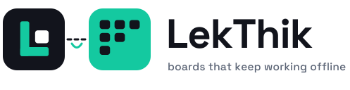
</picture>

**Boards, lists and cards you arrange the way you think. Shared live, built to be used by everyone.**

A collaborative task board in the spirit of Trello. Lists and blocks sit on a free grid you lay out yourself, cards are written in Markdown with formulas and diagrams, a `Ctrl+K` palette does everything from the keyboard, and what one person changes appears on everyone else's screen at once.


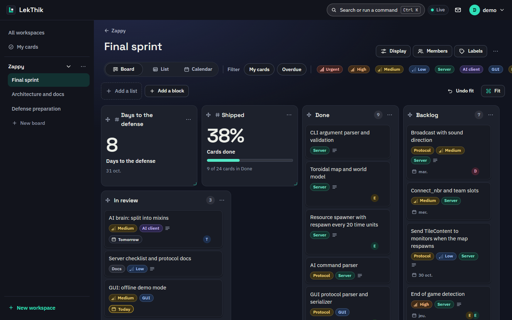

**[Live demo](https://lekthik.weier-corp.fr) · [Privacy notes](docs/privacy.md) · [API reference](#api)**

</div>

## Contents

- [What it does](#what-it-does)
- [Screenshots](#screenshots)
- [Quick start](#quick-start)
- [Boards, blocks and cards](#boards-blocks-and-cards)
- [The command palette](#the-command-palette)
- [Live updates](#live-updates)
- [Architecture](#architecture)
- [Accessibility](#accessibility)
- [Privacy and security](#privacy-and-security)
- [API](#api)
- [Testing](#testing)
- [Configuration](#configuration)
- [Project structure](#project-structure)
- [Deployment](#deployment)
- [Contributing](#contributing)
- [Status and known limitations](#status-and-known-limitations)

## What it does

Most boards force one shape: a row of columns. LekThik lets the board take the shape of the work.

1. **Create an account** with an email and a password, confirm the address with the six digit code that arrives by email.
2. **Make a workspace**, invite people by email and give them a role: reader, writer, admin or owner. Start a board from a template (sprint planning, bug tracker, content calendar and more) or from nothing.
3. **Lay it out.** Keep the classic row of columns, or switch to the **Canvas**, where lists and blocks are tiles on a 12 column grid. Drag them anywhere, one under another or side by side, resize them from the corner, or press **Fit** and let LekThik arrange them. The canvas layout is shared, so everyone sees the same one.
4. **Write.** A card has assignees, a due date, coloured labels with a priority and a description in Markdown: tables, checklists, code, LaTeX formulas and Mermaid diagrams.
5. **Add blocks.** A calendar, an agenda, a counter, a progress ring, a note, a picture, a video or a link sit beside the lists and draw on the cards of the board.
6. **See it four ways.** The same cards as columns, on a free canvas, in a sortable table or in a calendar of due dates.
7. **Do it from the keyboard.** `Ctrl+K` jumps to anything and adds, moves, assigns or schedules without touching the mouse.
8. **Work together.** Nothing needs a refresh: cards, layouts and members follow what others do, and a reconnection catches up on what was missed.

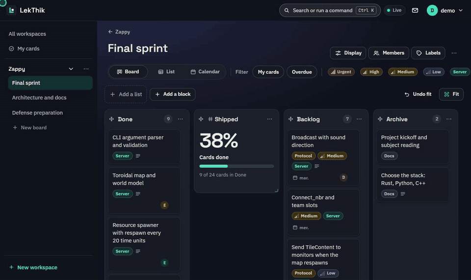

## Screenshots

| Cards in the table view | Calendar of due dates |
| --- | --- |
| 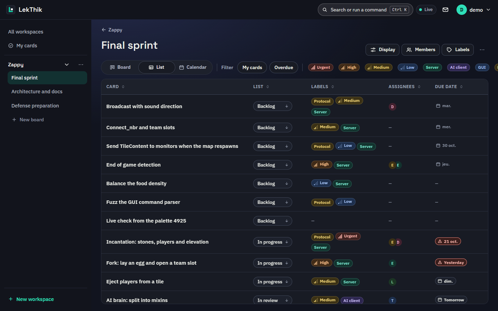 | 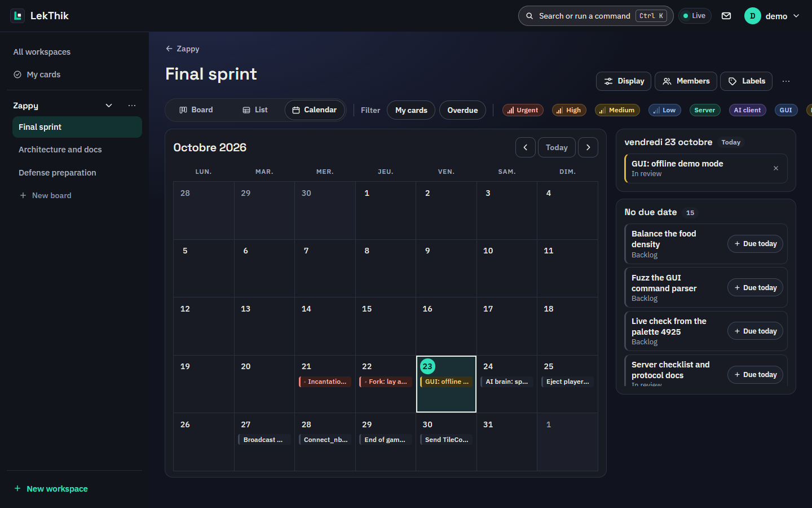 |
| **A card with a diagram and a table** | **The command palette** |
| 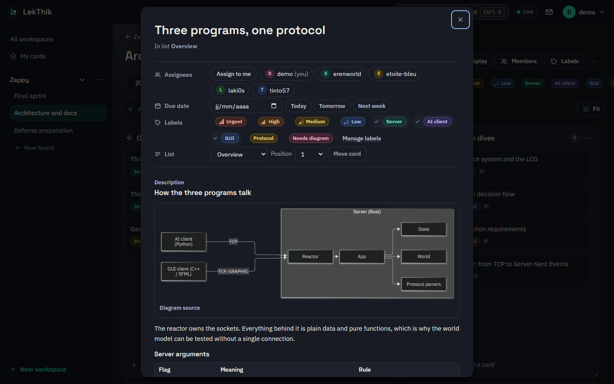 | 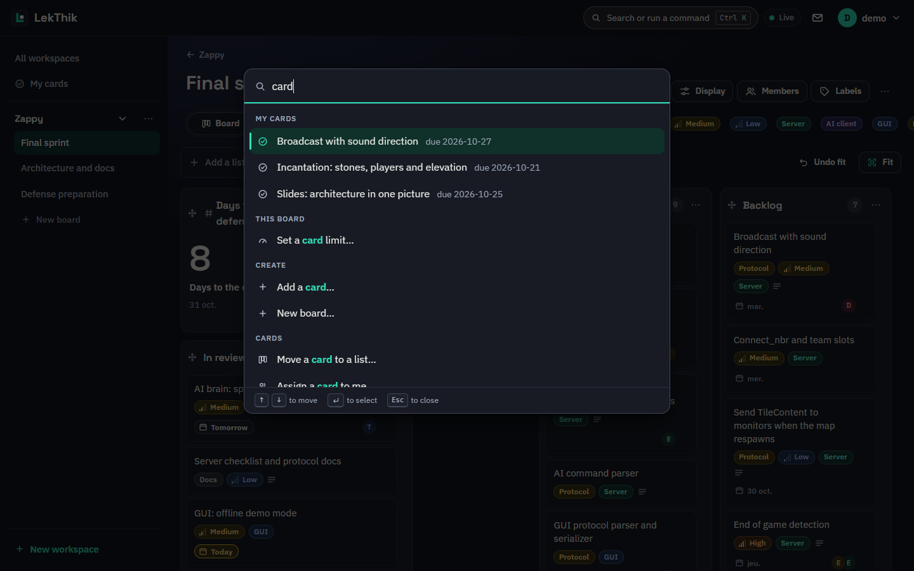 |
| **Light theme** | **On a phone** |
| 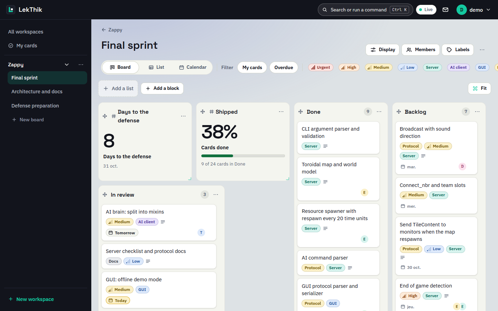 | 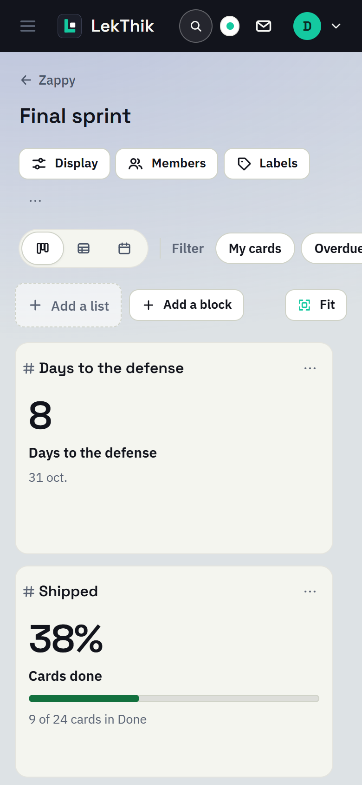 |

## Quick start

You need Docker with Compose. Nothing else is installed on your machine.

```bash
git clone https://github.com/Etoile-Bleu/LekThik.git
cd LekThik

cp .env.example .env
```

Open `.env` and set a strong `JWT_SECRET` and the database password. To send the verification and invitation emails, fill the SMTP block (`SMTP_RELAY`, `SMTP_USERNAME`, `SMTP_PASSWORD`, `MAIL_FROM_EMAIL`), for example with a free [Brevo](https://app.brevo.com/settings/keys/smtp) relay.

```bash
docker compose -f docker-compose.dev.yml up --build
```

This starts PostgreSQL, applies the migrations, and brings up the API and the web app with hot reload.

| Service | URL |
| --- | --- |
| Web app | http://localhost:5173 |
| API | http://localhost:8080 |
| API documentation (Swagger UI) | http://localhost:8080/swagger-ui |

The first Rust build takes a couple of minutes because the cargo cache starts empty. Wait for the server to report it is connected to PostgreSQL, then open the web app and register. Pages that use diagrams or formulas load their code the first time they are needed, so the very first one is slower in development.

`docker compose up` builds the production images instead, and [Deployment](#deployment) shows how the live site is shipped. Service specific commands are in [backend/README.md](backend/README.md) and [frontend/README.md](frontend/README.md).

## Boards, blocks and cards

**A board can be a row of columns or a canvas.** The **Board** view is the classic row: lists and blocks side by side, lists that fold into a slim rail, three column widths, and a drag handle to reorder. The **Canvas** view lets you lay everything out yourself: every list and block is a tile on a 12 column grid. Take a tile by its name to move it, take its edges or corner to resize it. While it is held the other tiles glide aside, a dashed outline shows where it will land and nothing ever overlaps. **Fit** arranges everything in the most readable way and keeps the order, **Undo fit** brings the previous layout back, and without a mouse `Space` picks a tile up, the arrow keys move it, `Shift` with them resizes it and `Enter` drops it. On a phone the tiles stack in reading order.

**Blocks** sit among the lists and draw on the cards of the board, so they update with no request of their own.

| Block | What it shows |
| --- | --- |
| Calendar | A small month with a dot on every day that has cards due, and the cards of the chosen day |
| Agenda | What is due today or over seven days, late cards first, optionally only yours |
| Counter | One number: late cards, share done, days left to a date or total cards |
| Progress | A ring or a bar for the share of the cards that sit in the list that means done, drawn once and written out in words |
| Chart | Cards by list, label, person or due date as bars or a donut, in a colour blind safe palette, with the same numbers in a table behind it |
| Timer | A focus and break timer the whole board follows. Whoever can edit starts, pauses, resets or adds five minutes, everyone sees the same time because it is kept as an end time and not as ticks |
| Clocks | The time in up to six places, with summer time followed by the browser, who is awake, the hours when everyone is at work, and optionally the weather from Open-Meteo, requested only after a press |
| Table | A small spreadsheet edited in place with the keyboard, up to 100 rows and 12 columns. Paste cells or a CSV file, number columns add up, and the CSV export neutralises formulas. Cells are text, never evaluated |
| Code | A command, a config or a query in one of 16 languages, highlighted, with an optional file name, line numbers and a copy button. It is shown as text and never run |
| My late cards | The cards assigned to you that are past their date, most late first. Everyone who opens the board sees their own |
| Note | Markdown text with checklists you can tick |
| Picture | An image kept in LekThik's own database, with its metadata removed and a description as alternative text |
| Embed | YouTube, Vimeo, Google Calendar, Excalidraw, Figma or a published Notion page, loaded only after a person presses a button that names who receives what |
| Link | A plain link to a site, fetching nothing |

**Cards** carry up to ten assignees, a due date that reads `Today`, `Yesterday` or a date with an icon and words rather than a colour, labels with a priority, and a description written in Markdown with GitHub tables, checklists, highlighted code, LaTeX formulas drawn by KaTeX (as HTML for the eye and MathML for screen readers) and Mermaid diagrams. Lists can carry a work in progress limit that warns without ever blocking.

**Full screen.** A button in the top bar (or the palette) hides the bars and leaves only the board. The menu slides in from the left edge when the pointer reaches it.

**Views.** The board, the canvas, a sortable table and a calendar share the filters (by label, mine, overdue). **My cards** gathers everything assigned to you across workspaces, grouped overdue, today, next seven days and later.

## The command palette

`Ctrl+K` (or `Cmd+K`, or the search button in the top bar) opens one field that goes anywhere and does anything.

- **Jump** to a board, a card, a settings page or one of the cards assigned to you.
- **Act**: add a card, a list or a block, move a card to another list, set a due date by typing `tomorrow`, `friday`, `+3d` or `2026-03-14`, assign a card to yourself, rename, filter, switch view, fit the layout, change the theme.
- **Ask**: an action that needs details asks one question at a time, with the trail shown above the field. `Backspace` on an empty field and `Esc` step back.
- **Find fast**: a fuzzy search that ignores case and accents, highlights what matched, remembers the commands you used last (in this browser only) and offers readers only what they may do.

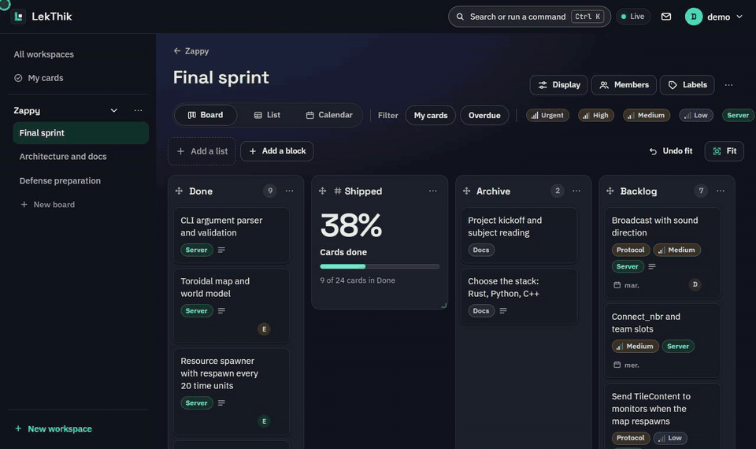

It is built as an ARIA combobox: focus stays in the field, `aria-activedescendant` follows the arrow keys, and the number of results is announced.

## Live updates

Everything a person changes is shown to the others without a refresh. The server keeps one Server-Sent Events stream per open page and tells each member only about the workspaces and boards they may see, and a change to membership refreshes that audience immediately.

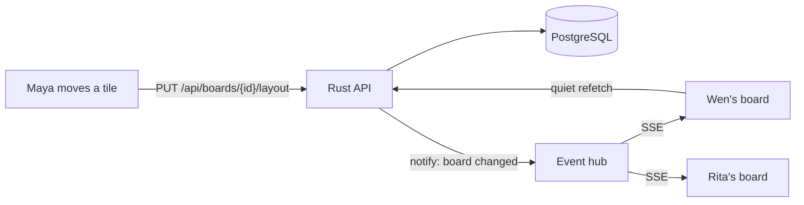

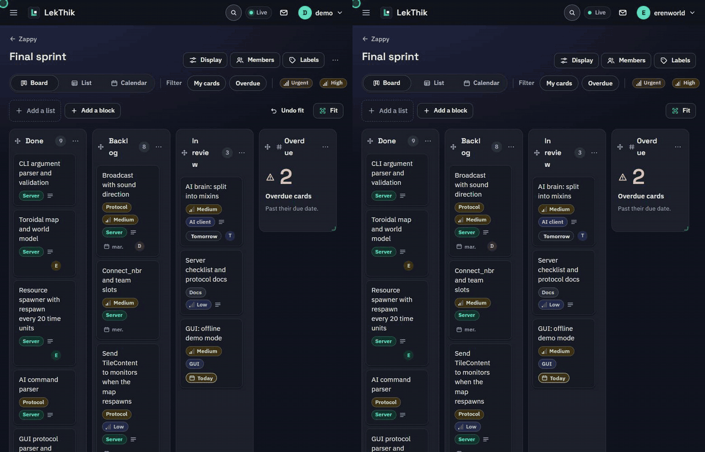

A page that lost its connection reconnects with backoff and catches up on what it missed, and the "Live" badge in the top bar says whether the stream is open. Changes you make yourself appear at once and are corrected if the server refuses them.

## Architecture

The backend is hexagonal. Business rules sit in the middle and know nothing about HTTP or SQL, everything external plugs in through a trait, and one composition root binds each trait to a concrete adapter. Queries are scoped to the signed in member in SQL, so a stranger gets the same answer for a board that does not exist and one they may not see.

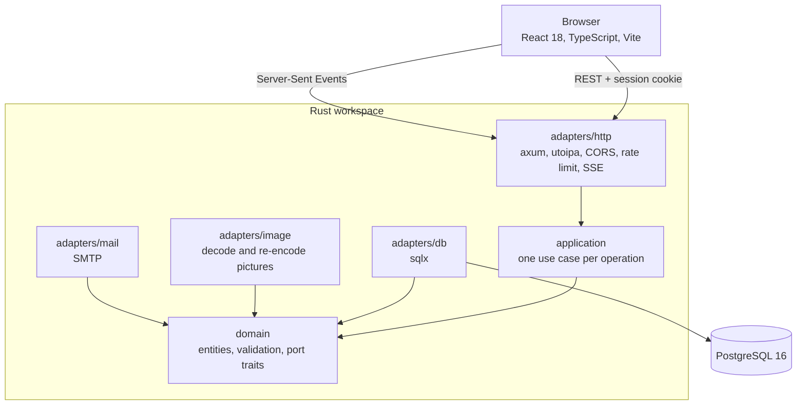

Lists and blocks are rows of one table with a `kind` and a validated JSON `config`, so moving, renaming, deleting, permissions and live updates are written once. The free layout is four nullable columns on the same rows, stored for a whole board in one transaction. The frontend keeps state in small Zustand stores, draws with plain CSS driven by design tokens, and loads heavy code (Markdown, KaTeX, highlighting, Mermaid) only when a text needs it.

## Accessibility

LekThik is built and audited against WCAG 2.2 AA, and checked in a real browser with axe-core on every new screen.

- **Keyboard and screen reader**: every action has a keyboard path, focus is visible and never lost, dialogs are native `<dialog>` elements, and changes are announced through one polite live region. Dragging always has a non-dragging alternative.
- **Nothing by colour alone**: due dates, limits, labels and priorities carry an icon, a shape or words as well.
- **Appearance settings**: light, dark and high contrast themes, three densities, text up to 150%, a dyslexia friendly font, wider spacing, red-green and blue-yellow palettes, larger targets, a thick focus ring and a reduced motion mode.
- **Responsive**: layouts use container queries measured in `rem`, so they give way as text grows, and the board stacks on a phone.

## Privacy and security

- **No tracking.** No analytics, no advertising, no cookies except the session cookie (`HttpOnly`, `Secure`, `SameSite=Lax`). Fonts are bundled with the app, so opening LekThik sends nobody's address to another company.
- **Nothing is requested from a third party until a person asks.** An embed block shows a placeholder that says who would receive what, and only loads after a press.
- **Passwords** are hashed with Argon2, verification and reset codes are stored hashed and expire in minutes, and sign in and sign up are rate limited.
- **Uploads are rebuilt.** A picture is decoded and written again from its pixels, which drops every piece of metadata (GPS position, camera, time, author, hidden trailing data). Only real PNG, JPEG and WebP pass, judged by their bytes, never SVG.
- **Text is never read as HTML.** Markdown goes through `react-markdown` without raw HTML, links keep only web and mail addresses, pictures from other sites are never fetched, Mermaid runs in strict mode with its output cleaned, and KaTeX runs with `trust` off.
- **Roles are checked in SQL**, and every collection has a cap (panels per board, cards per list, members per workspace).

[docs/privacy.md](docs/privacy.md) lists what is stored, why, who sees it and for how long, and says plainly what is not done yet.

## API

The OpenAPI description is served by the backend: Swagger UI at `/swagger-ui` and the raw document at `/api-docs/openapi.json`. The main groups:

| Group | Examples |
| --- | --- |
| Account | `POST /api/users/register`, `POST /api/auth/login`, `POST /api/auth/verify-email`, `POST /api/auth/forgot-password` |
| Workspaces | `GET /api/workspaces`, `POST /api/workspaces/{id}/boards`, `POST /api/workspaces/{id}/invitations` |
| Boards | `GET /api/boards/{id}`, `PUT /api/boards/{id}/look`, `PUT /api/boards/{id}/layout`, `POST /api/boards/{id}/blocks` |
| Lists and blocks | `POST /api/lists/{id}/move`, `PUT /api/lists/{id}/wip-limit`, `PUT /api/blocks/{id}/config`, `PUT /api/blocks/{id}/image` |
| Cards | `POST /api/lists/{id}/cards`, `PATCH /api/cards/{id}`, `PUT /api/cards/{id}/assignees`, `GET /api/users/me/cards` |
| Live | `GET /api/events` (Server-Sent Events) |
| Preferences | `GET` and `PUT /api/users/me/preferences` |

Endpoint details and limits are in [backend/README.md](backend/README.md).

## Testing

```bash
# Backend: formatting, lints, unit and integration tests (the latter start PostgreSQL in a container)
cd backend
cargo fmt --check
cargo clippy --all-targets -- -D warnings
cargo test --workspace

# Frontend: types, lints, formatting, unit and component tests, production build
cd frontend
pnpm install
pnpm exec tsc --noEmit
pnpm exec eslint src --max-warnings 0
pnpm exec prettier --check "src/**/*.{ts,tsx,css}"
pnpm exec vitest run
pnpm exec vite build
```

The backend integration tests run the real migrations against a disposable PostgreSQL and cover permissions (reader, writer, stranger), limits, validation and what is deleted with a board. The frontend has more than 600 tests, and each new screen was also audited in a real browser with axe-core on desktop and on a phone. Continuous integration scans for leaked secrets and checks dependencies.

## Configuration

Everything is read from the environment (see `.env.example`).

| Variable | Purpose |
| --- | --- |
| `POSTGRES_DB`, `POSTGRES_USER`, `POSTGRES_PASSWORD`, `POSTGRES_PORT` | The database, and the host port to publish when 5432 is taken |
| `JWT_SECRET` | Signs session tokens. Use a long random value |
| `CORS_ALLOWED_ORIGINS` | Origins allowed to call the API, comma separated. An empty or invalid list denies every origin |
| `SMTP_RELAY`, `SMTP_USERNAME`, `SMTP_PASSWORD` | The mail relay for verification codes and invitations |
| `MAIL_FROM_EMAIL`, `MAIL_FROM_NAME` | The sender of those emails |
| `APP_BASE_URL` | Public address of the web app, used in the links of invitation emails |

## Project structure

```text
LekThik/
├── backend/                  Rust workspace
│   ├── domain/               Entities, validation and port traits, no I/O
│   ├── application/          One use case per operation
│   ├── adapters/
│   │   ├── http/             axum routes, DTOs, OpenAPI, rate limiting, live events
│   │   ├── db/               sqlx repositories, membership scoped queries
│   │   ├── image/            Picture decoding and re-encoding
│   │   └── mail/             SMTP
│   └── migrations/           Numbered SQL migrations
├── frontend/                 React and TypeScript
│   └── src/ui/
│       ├── components/       board, command, richtext, settings, collab, app, ui
│       ├── pages/            Workspaces, board, my cards, settings, sign in
│       ├── lib/              Stores, API client, grid maths, fuzzy search, helpers
│       ├── hooks/            Shared hooks
│       └── styles/           Design tokens, themes, accessibility rules
├── docs/                     Privacy notes and images
└── docker-compose*.yml       Development, production and server stacks
```

## Deployment

The `Deploy to VPS` workflow (Actions tab, Run workflow) builds the `main` branch, ships the images to the server and restarts the stack at https://lekthik.weier-corp.fr. Anyone with write access to the repository can run it.

It reads these secrets from the `production` environment, which only the `main` branch can use: `VPS_SSH_PRIVATE_KEY`, `VPS_SSH_HOST`, `VPS_SSH_USER`, `VPS_DEPLOY_DIR`, `CF_ACCESS_CLIENT_ID` and `CF_ACCESS_CLIENT_SECRET`. The application secrets (database password, JWT secret, SMTP) stay in the `.env` file of the deploy directory on the server, created once from `.env.example`, and are never stored in GitHub. The site is exposed through a Cloudflare Tunnel, with no host port published.

## Contributing

See [CONTRIBUTING.md](CONTRIBUTING.md) for the git workflow, commit conventions and code standards. This project follows a [Code of Conduct](CODE_OF_CONDUCT.md).

## Status and known limitations

LekThik is built as part of the Simulated Professional Work program, to show that [ZamSync](https://github.com/Etoile-Bleu/ZamSync), an offline-first replication engine, can be added to a finished application. These are the honest edges today:

- **Offline use and multi-site replication are not in yet.** That is what ZamSync is meant to add, and the backend is shaped to allow it.
- **Exporting and deleting a whole account is not in the app.** [docs/privacy.md](docs/privacy.md) says so.
- **No comments or activity history on cards yet**, and no notifications other than the live updates and invitation emails.
- **Ownership of a workspace cannot be transferred**, and a username cannot be edited.
- **Searching is done from the command palette** over what is loaded: the open board, your assigned cards and your boards. There is no search across every card of every workspace.
- **A pointer drag is checked in a real browser, but touch dragging on tablets has had less testing** than the keyboard and form alternatives.

## License

MIT, see [LICENSE](LICENSE).
